# A Distribution-Free Confidence Band for the ROC Curve

We present a simultaneous confidence band for the **true population ROC curve**. It makes
no assumption about the score distributions, is about half the area of the
Kolmogorov–Smirnov band, and holds coverage on heavy-tailed, skewed, and
multimodal scores where the binormal band fails.

The method is a **rank-space fiducial band** with a **localized exact floor**
at the two corners of the curve. 

The construction and its theory are in
[`stats/fiducial_band_theory.md`](stats/fiducial_band_theory.md). The
simulation design is in [`stats/simulation_spec.md`](stats/simulation_spec.md).
All numbers below come from three simulation runs at 50%, 30%, and 10%
prevalence: seven data-generating processes (DGPs), 6,000 parameter draws per
DGP, n = 10 to 10,000, and 50%, 80%, and 95% bands. That is 12.6 million band
evaluations for the five methods shown here. Results are at 50% prevalence
unless stated.

---

## 1. The problem with the methods we have

There are two gold-standard ROC bands: bands that assume normality and are ideal when the assumption is met, and uniform bands drawn from nonparametric approaches that guarantee coverage.

**Working–Hotelling assumes the scores are binormal.** It models the ROC as
`TPR = Φ(a + b·Φ⁻¹(FPR))` and puts a regression band around the fitted line in
probit space (Working & Hotelling 1929; Ma & Hall 1993). When both score
distributions are Gaussian, the band is tight and its coverage is correct. When
they are not, the band converges to the wrong curve. More data makes this
worse: the band tightens around a biased estimate and coverage falls toward
zero.

**The KS band is distribution-free but wide.** It puts a fixed margin around
the empirical ROC, `c/√n₁` vertically and `c/√n₀` horizontally, from the
Dvoretzky–Kiefer–Wolfowitz inequality applied to each class (Campbell 1994;
Massart 1990). It covers, but it over-covers: its 50% band contains the true
curve 99% of the time. The margin is the same at the steep low-FPR corner as in
the flat interior, so it says little about where the curve is.

**A more useful band would combine the best properties of both**:

1. **Distribution-free.** No parametric model for the scores, works for all data.
2. **Informative.** Much narrower than KS, with width that follows the local
   uncertainty.

### Is distribution-free really needed? Logistic regression assumes normality.

Non-binormal scores are extremely common.

- **Heavy tails.** Network logits and many probability outputs have heavier
  tails than a Gaussian. A few extreme scores determine the low-FPR corner of
  the ROC.
- **Skew and bounded support.** Probabilities lie in `[0, 1]` and pile up at
  the ends. Risk scores are often right-skewed. Using logits instead of
  probabilities does not change the ROC curve, but it changes the
  Working–Hotelling band around it.
- **Multimodality.** A population that mixes subgroups has multimodal scores.
  The ROC then has inflections that no binormal curve can follow.

---

## 2. The fiducial band

The ROC curve depends on the scores only through their ranks. Transform every
score by `s → 1 − F(s)`, where `F` is the negative-class CDF. The negatives
become uniform on `(0, 1)`, and the CDF of the positives becomes the true ROC
curve. So the interleaving of the two samples carries everything the data say
about the ROC.

For any continuous distribution, the CDF values at a sample's own order
statistics have a known law: their spacings are `Dirichlet(1, …, 1)`. This is
exact at every sample size. The band uses it in three steps.

1. **Cloud.** Draw 20,000 pairs of spacing vectors, one for each class. Each
   pair places the negatives on the FPR axis and the positives on the TPR axis.
   Join the points in rank order to get one candidate ROC curve per draw.
2. **Trim.** At each FPR grid point, rank the draws. Take the band between the
   j-th smallest and j-th largest draw at every grid point. Choose j so that a
   `1 − α` share of the draws lies inside the band everywhere. Every grid point
   gets the same local tail level.

This is followed by some minimal housekeeping: raise the upper edge to a binomial bound where the empirical TPR reaches 1, and set the lower edge to 0 where no positive exceeds the threshold.

The band uses only ranks, so its coverage depends on the data only through the
true ROC curve and the two sample sizes. A monotone transform of the scores
does not change it. The only tuning input is the number of draws.

The figure shows 95% bands on one dataset from each of three distributions.

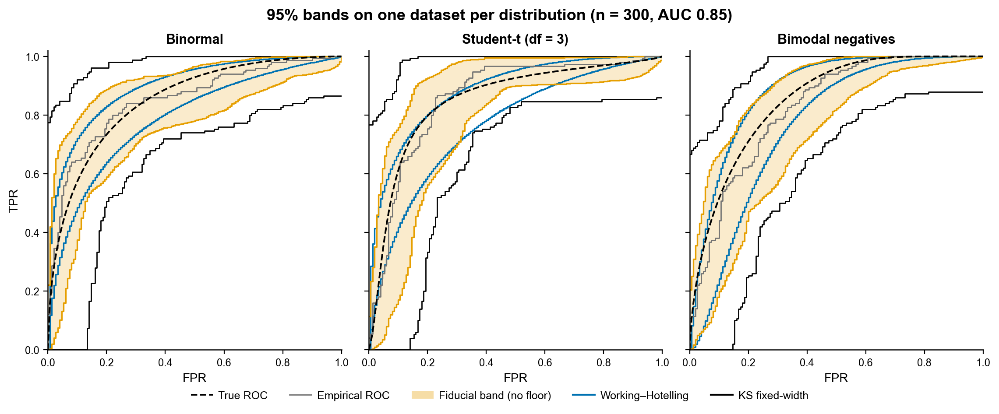

The fiducial band (orange) is much narrower than KS (black) in every panel. It
is wider than Working–Hotelling (blue). In the Student-t panel the true curve
leaves the Working–Hotelling band. These are single datasets, shown for
illustration. The evidence is in the simulations below.

---

## 3. Coverage: the fiducial band against Working–Hotelling

The heatmaps show coverage for 95% bands. White is nominal, blue is
conservative, red is under-coverage.

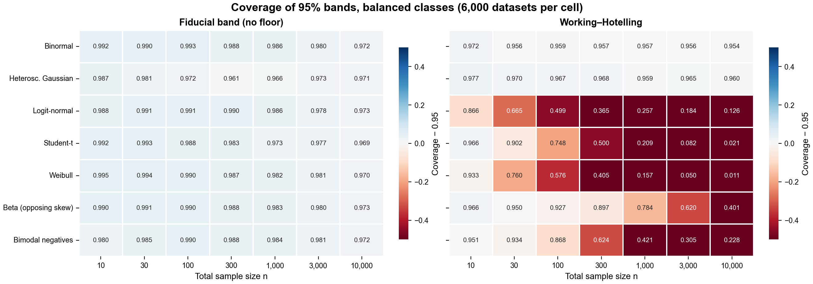

The fiducial band covers between 0.961 and 0.995 in all 49 cells. No cell is
significantly below nominal at the 95%, 80%, or 50% level. Working–Hotelling
holds 0.954–0.977 on the two Gaussian families. On the other five it falls with
n. At n = 10,000 it covers 0.401 on Beta, 0.228 on bimodal negatives, 0.126 on
logit-normal, 0.021 on Student-t, and 0.011 on Weibull scores.

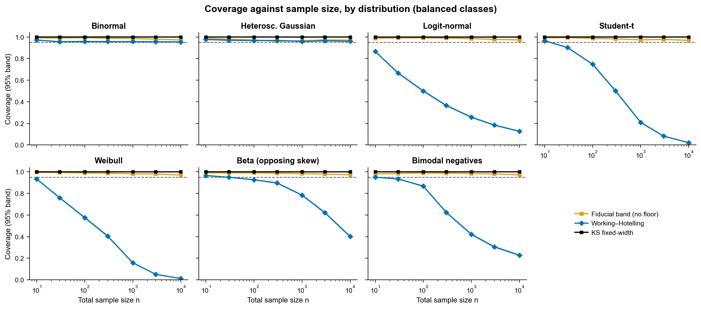

The failure of Working–Hotelling is gradual. It grows as the scores move away
from the binormal model:

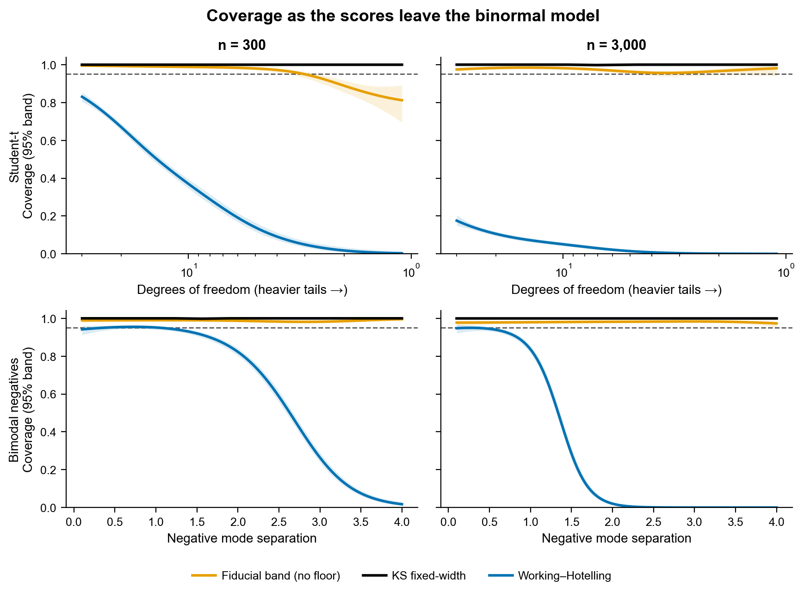

Each panel sweeps one distribution's shape parameter. Each curve is one sample
size, from n = 10 (dark) to n = 10,000 (light). Working–Hotelling coverage
falls as Student-t and Weibull tails get heavier, as the logit-normal σ grows,
as the Beta skew strengthens, and as the negative modes separate. Wherever the
scores depart from binormal, the larger samples are lower. The one flat panel
is the heteroscedastic Gaussian, where the binormal model holds at every σ
ratio.

### Calibration across confidence levels

The same comparison at the 50%, 80%, and 95% levels, averaged over the seven
distributions. A calibrated band lies on the dashed line.

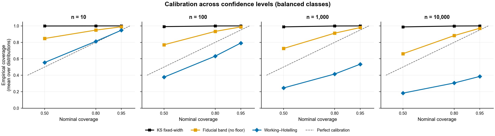

- **KS** covers at least 0.99 at every level. It does not respond to the
  requested level.
- **Working–Hotelling** is on the line at n = 10 and falls further below it at
  every larger n.
- **The fiducial band** is above the line at every level, and closest to it of
  the three from n = 100. Its 95% band covers 0.97–0.99. Its 80% band covers
  0.95 at n = 10 and 0.88 at n = 10,000. Its 50% band covers 0.85 at n = 10
  and 0.66 at n = 10,000. The over-coverage shrinks with n.

---

## 4. Width: the fiducial band against KS

Each panel plots coverage against mean band area for one distribution and
sample size. The best position is on the dashed nominal line and to the left.

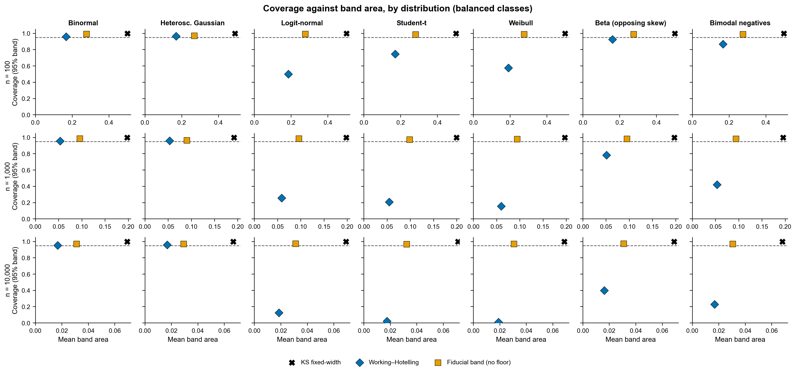

KS (black) is always the widest. Working–Hotelling (blue) is the narrowest, but
it is far below nominal outside the two Gaussian families. The fiducial band
(orange) is just above nominal in every panel, at about half the KS area.

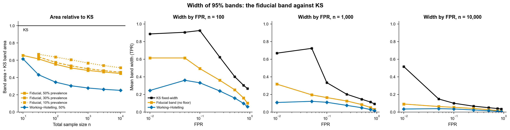

The fiducial band captures our primary goals: maintains coverage while barely sacrificing width.

However, there are a few cases where the fiducial band runs into problems.

---

## 5. Where the fiducial band fails

The fiducial band shows problems with heteroscedastic data, and it gets worse at low prevalence. 

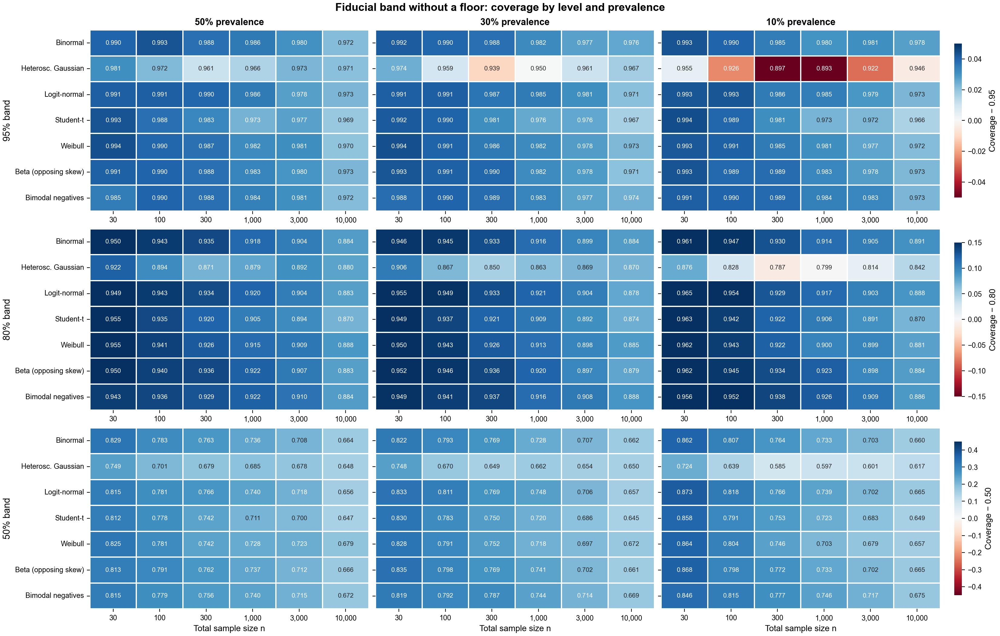

A row average understates the failure, because only some draws in a row cause
it. Splitting the draws by shape and true AUC locates it (95% bands):

- **Dispersed positives at high AUC.** For heteroscedastic-Gaussian draws with
  σ₊/σ₋ > 2 and AUC > 0.95, coverage is 0.89 at n = 300 and 0.91 at n = 1,000.
  At 30% prevalence it is 0.80 and 0.85. At 10% prevalence it is 0.75 and 0.64.
- **Heavy tails at high AUC.** For Student-t draws with df < 4 and AUC > 0.95,
  coverage is 0.77 at n = 300 and 0.80 at n = 1,000. At 10% prevalence it is
  0.64 at n = 1,000. These draws are 3% of the Student-t design, so the
  Student-t row of the heatmap does not show them.
- **Imbalance widens the failure.** At 10% prevalence the dispersed-positive
  draws also fail at AUC ≤ 0.90, with coverage of 0.86–0.93 for n = 30 to 300.
- **Not monotone in n.** Coverage is worst at n = 300 to 1,000. By n = 10,000
  it is back to 0.94–0.96 at 50% and 30% prevalence and 0.86 at 10%.
- **Everything else is fine.** On all other draws coverage is 0.97–0.99 at
  every n, AUC, and prevalence.

Section 7 plots these strata with and without the floor.

### The corners are the problem

The misses are in the corners, where the true ROC exits the lower bound.

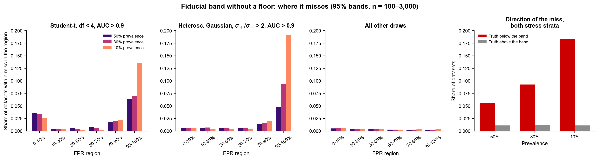

- **Location.** Misses concentrate at FPR 90–100%, the TPR plateau. Student-t draws also miss at FPR 0–10%.
- **Direction.** The true curve falls below the band. Below-band misses occur
  in 5.6%, 9.3%, and 18.4% of datasets at 50%, 30%, and 10% prevalence.
  Above-band misses stay between 1.1% and 1.3%.

The cause is how the cloud fills gaps. Between two neighboring observations
each draw interpolates linearly. In the interior the gaps are small and this is
harmless. At the two ends it is not. The gap before the largest negative, and
the run of negatives below the smallest positive, each carry large relative
uncertainty. If the true ROC is convex there, it sags below the straight chord
that the cloud draws. Heavy tails make the ROC convex at both ends. Positives
that are more dispersed than the negatives make it convex near FPR = 1.
Imbalance lengthens the run of negatives below the smallest positive: its
median length at n = 1,000 is 38, 69, and 170 negatives at 50%, 30%, and 10%
prevalence. That is why the failure grows as positives become scarce.

The fiducial band has no finite-sample guarantee, and at the corners its
first-order justification does not apply. The corners need a band that does
have a guarantee. KS has one, but it is too wide. The next section gives a
better one.

---

## 6. An exact band that beats KS: the ELL band

KS builds its ROC band from two one-sample CDF bands, one for each class, and
composes them by monotonicity (Campbell 1994). The equal-local-levels (ELL)
band uses the same composition with better class bands.

1. **Class band.** For one class, the CDF at the i-th order statistic follows
   `Beta(i, n + 1 − i)` exactly. Bound each order statistic by the `γ` and
   `1 − γ` quantiles of its own Beta law. The same local level `γ` is used at
   every order statistic (Berk & Jones 1979; Owen 1995; Aldor-Noiman et al.
   2013).
2. **Exact calibration.** The probability that all n bounds hold at once is a
   boundary-crossing probability of uniform order statistics. It is computed
   exactly, without Monte Carlo (Noé 1972; Moscovich & Nadler 2017). `γ` is set
   so each class band has its target simultaneous level.
3. **Composition.** The two class levels multiply to `1 − α`. Every pair of
   CDFs inside the two class bands maps to an ROC curve, and the band is the
   envelope of those curves.

This gives a **finite-sample theorem**: for every pair of continuous score
distributions and every sample size, the ELL band contains the entire true ROC
with probability at least `1 − α` (theory doc, Proposition 12). Ties are
handled by random tie-breaking.

The KS margin is constant, so it is sized for the middle of each class
distribution and is far too wide in the tails. The ELL bounds follow the Beta
law of each order statistic and tighten in the tails.

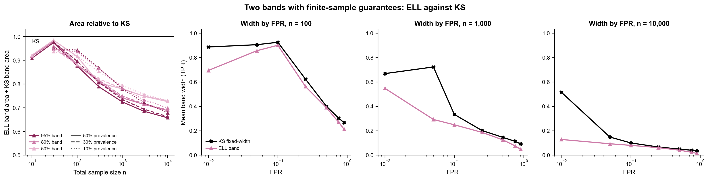

- **Area (left).** The ELL band's area is significantly thinner than KS.
- **No weak spot (middle, right).** The ELL band solves the weaknesses of the Fiducial band.

The narrowing costs no coverage anywhere. The heatmaps show every cell at every
level.

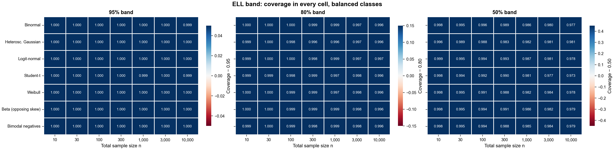

The same holds under class imbalance.

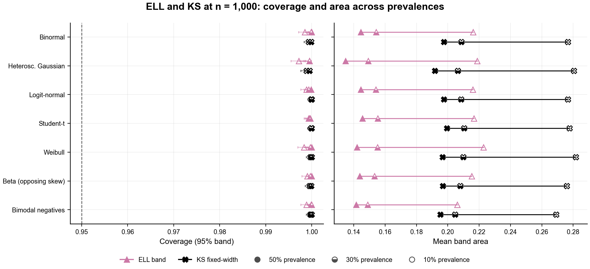

ELL covers at least 0.997 for every distribution at every prevalence. Its area
is smaller than KS's for every distribution at every prevalence: about 0.14
against 0.20 at 50% prevalence and 0.22 against 0.28 at 10%. Both bands widen
as positives become scarce.

**The ELL band carries the same kind of guarantee as KS with less width.** It is
the better guaranteed band. It is still not the band to use everywhere: its
area is about 1.5 times the fiducial band's, and it barely responds to the
requested level. Its role here is as a floor.

---

## 7. The fiducial band with an ELL floor

The final method uses the ELL band where the fiducial band fails and the
fiducial band everywhere else.

1. **Find the floor region.** The region has two parts, each set by an exact
   law. On the left it is the first few negative order statistics, where the
   cloud's first gap can set the lower edge (7–9 points for a 95% band once
   n₀ ≥ 50). On the right it is the run of negatives below the smallest
   positive, extended by an exact binomial margin.
2. **Recalibrate the trim.** Recompute the fiducial trim depth using only the
   grid points outside the region. The floor handles the corners, so the
   fiducial band no longer spends level on them.
3. **Take the hull in the region.** Inside the region the band is the pointwise
   hull of the recalibrated fiducial band and the ELL band.
4. **Close.** Tighten the result to a monotone band.

The floor has no tuning parameter beyond two small error budgets, and it reads
only the ranks.

Two statements are exact for every ROC curve. A miss inside the floor region
implies that the ELL band missed somewhere, so the probability of a miss inside
the region is at most the ELL level. The probability of a miss anywhere is at
most the ELL level plus the probability that the recalibrated fiducial band
misses outside the region. That last term has no distribution-free bound. It is measured by
simulation.

The figure shows both bands on two datasets where the unfloored band misses at
a corner. The seeds were chosen for that reason.

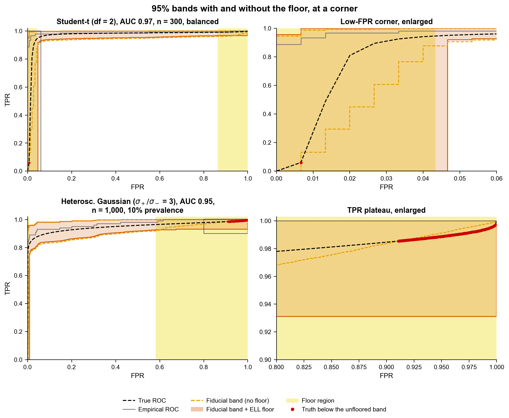

In the top row the unfloored lower edge (dashed) rises too fast at low FPR and
the true curve falls below it at the first grid point. The floored band keeps
its lower edge at zero through the floor region. In the bottom row the true
curve sags below the unfloored lower edge along the plateau. The floored band
takes the ELL lower edge there and covers.

### It repairs the failing strata

The figure shows coverage of both bands at true AUC > 0.9. Rows are the two
failing strata of Section 5 (Student-t with df < 4, heteroscedastic Gaussian
with σ₊/σ₋ > 2) and all other draws. Columns are prevalences. Bars are 95%
Wilson intervals.

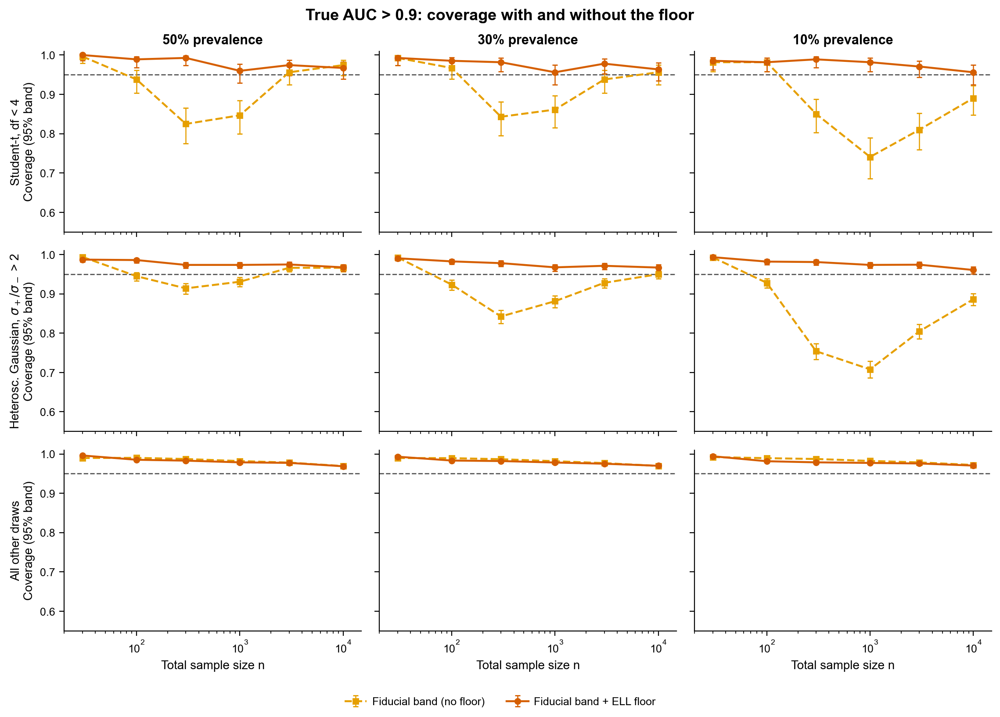

In the two failing strata the unfloored band falls as low as 0.71. The floored
band covers between 0.956 and 1.000 at every sample size and prevalence. On all
other draws the two bands agree to within 0.01.

### It holds coverage in every cell

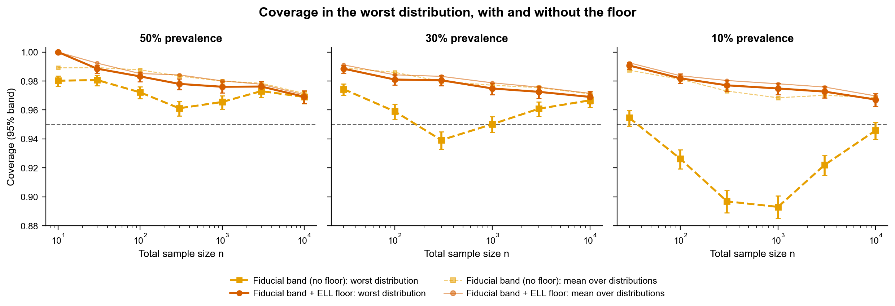

### It removes the corner misses and the directional bias

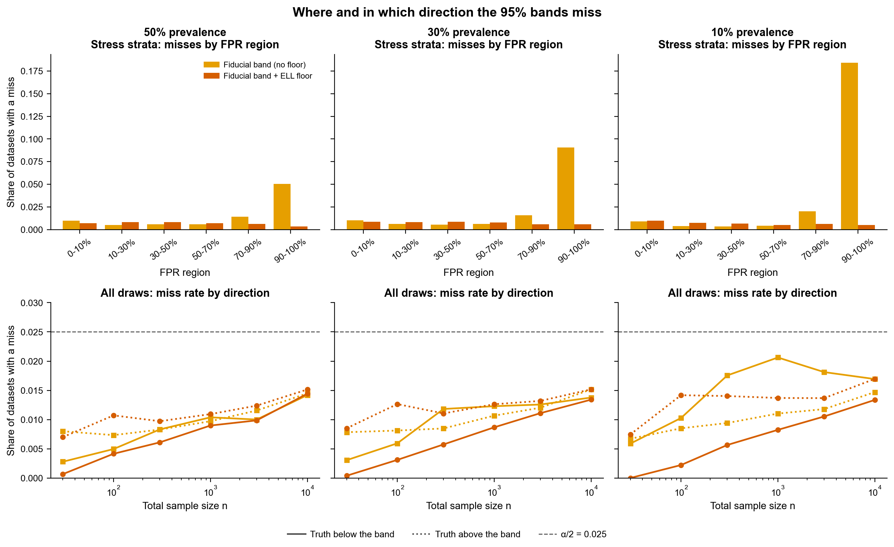

### The cost is small and fades with n

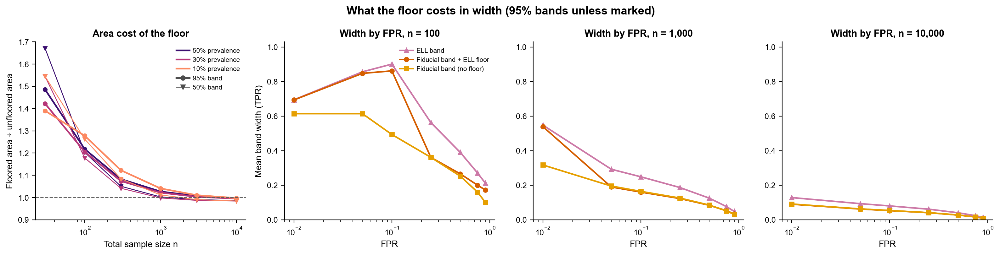

The floor region shrinks as data accumulate. The figure shows the share of
datasets whose floor region contains each FPR.

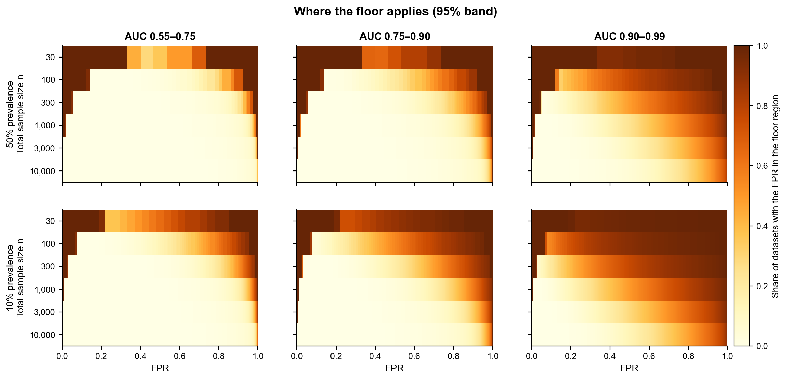

The left part ends after a fixed number of order statistics, so it shrinks like
1/n₀. The right part follows the TPR plateau, so it is longer at high AUC and
at low prevalence.

### Summary across prevalences

Sample sizes n = 30 to 10,000. Coverage is the mean over the 42 DGP × n cells.
"Cells below" counts cells whose 95% Wilson interval lies entirely below
nominal, out of 126 (42 cells × 3 levels).

| Prevalence | Method | Cov. 95% | Cov. 80% | Cov. 50% | Worst cell, 95% | Cells below | Area ÷ KS |
|---|---|---|---|---|---|---|---|
| 50% | Fiducial + ELL floor | 0.982 | 0.910 | 0.723 | 0.969 | 0 | 0.59 |
| 50% | Fiducial, no floor | 0.982 | 0.916 | 0.736 | 0.961 | 0 | 0.51 |
| 50% | ELL band | 1.000 | 0.998 | 0.986 | 0.999 | 0 | 0.79 |
| 50% | KS | 1.000 | 0.999 | 0.990 | 1.000 | 0 | 1.00 |
| 50% | Working–Hotelling | 0.619 | 0.495 | 0.298 | 0.011 | 85 | 0.31 |
| 30% | Fiducial + ELL floor | 0.981 | 0.907 | 0.717 | 0.969 | 0 | 0.61 |
| 30% | Fiducial, no floor | 0.980 | 0.913 | 0.737 | 0.939 | 1 | 0.53 |
| 30% | ELL band | 1.000 | 0.997 | 0.979 | 0.999 | 0 | 0.80 |
| 30% | KS | 1.000 | 0.999 | 0.989 | 1.000 | 0 | 1.00 |
| 30% | Working–Hotelling | 0.631 | 0.504 | 0.303 | 0.014 | 85 | 0.33 |
| 10% | Fiducial + ELL floor | 0.980 | 0.905 | 0.716 | 0.967 | 0 | 0.68 |
| 10% | Fiducial, no floor | 0.975 | 0.909 | 0.735 | 0.893 | 5 | 0.59 |
| 10% | ELL band | 0.999 | 0.991 | 0.952 | 0.997 | 0 | 0.82 |
| 10% | KS | 1.000 | 0.996 | 0.978 | 0.998 | 0 | 1.00 |
| 10% | Working–Hotelling | 0.690 | 0.546 | 0.323 | 0.034 | 80 | 0.43 |

The area ratio is the mean over all 42 cells, so it is dominated by small n,
where the floor is widest.

---

## 8. What the theory says

The full account is in
[`stats/fiducial_band_theory.md`](stats/fiducial_band_theory.md).

- **Rank reduction is exact.** The class labels in score order are a maximal
  invariant under monotone score transforms. A rank-based band has the same
  coverage for every score distribution that gives the same ROC curve. This
  does not make coverage the same for different ROC curves.
- **The interior is asymptotically calibrated.** On a fixed interior interval
  with a smooth ROC, the fiducial cloud reproduces the Gaussian limit of the
  empirical ROC process (Hsieh & Turnbull 1996), and the trim becomes a
  studentized simultaneous band. This is a proof outline, not a finite-sample
  theorem.
- **The band over-covers at second order.** The band is centered on a smoothed
  version of the empirical ROC, so the true curve sits more comfortably inside
  the cloud than a typical draw. This is why coverage is 0.97–0.99 at the 95%
  level and well above nominal at the 50% level.
- **The corners are a different problem.** At the ends, uncertainty is set by a
  few extreme order statistics, not by a Gaussian limit. Linear gap-filling is
  wrong there when the ROC is convex. No fiducial calibration fixes this.
- **The ELL band is exact.** Its guarantee is finite-sample and
  distribution-free. It over-covers because the composition discards
  information.
- **The floored band is partly proved.** Misses inside the floor region are
  bounded by the ELL level. Misses outside it are not bounded by any theorem.
  The simulations found no cell below nominal, but they are evidence for the
  shapes tested, not a proof for all ROC curves.

### Limitations

- The band is conservative. Expect about 0.97–0.99 coverage from a 95% band.
- It is a high-confidence tool. Its 50% band covers about 0.65–0.85.
- At low FPR and small n the floored band is as wide as the ELL band. No
  distribution-free band can be narrow there.
- The fiducial cloud is the slow part. Median time per dataset was 0.16 s at
  n = 100, 1.3 s at n = 1,000, and 9.6 s at n = 10,000, measured on one thread
  under the simulation's load. The ELL band takes milliseconds.
- Use the ELL band alone when a full-curve guarantee is required.

---

## Usage

```python
from studroc_paper.methods import M3Floor, fiducial_band_rs, m3_band_rs

# Fiducial band with the ELL floor (the recommended band)
fpr, lower, upper = fiducial_band_rs(
    y_true, y_score, alpha=0.05, m3_floor=M3Floor(), random_state=0
)

# Fiducial band without the floor
fpr, lower, upper = fiducial_band_rs(y_true, y_score, alpha=0.05, random_state=0)

# ELL band (finite-sample guarantee)
fpr, lower, upper = m3_band_rs(y_true, y_score, alpha=0.05, random_state=0)
```

The code calls the ELL band `m3` and the floored band `fiducial_hybrid`.

## Installation

Requires Python 3.12+, the [uv](https://docs.astral.sh/uv/) package manager,
and a Rust toolchain. The fiducial cloud and the ELL calibration run in a Rust
kernel (`rust/`) that `uv sync` builds.

```bash
git clone https://github.com/ndelaneybusch/studroc_paper.git
cd studroc_paper
uv sync
```

## Reproducing the figures

```bash
uv run python stats/readme_figures.py            # figures in this README
uv run python stats/paper_figures_nov11.py       # full figure set, one run
uv run python stats/paper_figures_prevalence.py  # cross-prevalence figure set
```

README figures are written to `figures/readme/`. The commentary on the full
figure sets is in `notebook_paper_nov11.py` and `notebook_paper_prevalence.py`.
The simulation is driven by `scripts/run_simulation.py` over the DGPs in
`src/studroc_paper/datagen/` and the methods in `src/studroc_paper/methods/`.

## Repository structure

```
studroc_paper/
├── src/studroc_paper/
│   ├── datagen/       # DGPs and true-ROC derivation
│   ├── methods/       # Band implementations (fiducial_band_rs.py, m3_band_rs.py,
│   │                  #   hybrid_floor.py, ks_band.py, working_hotelling.py, ...)
│   ├── eval/          # Coverage and width metrics
│   ├── sampling/      # Maximin Latin Hypercube Sampling
│   └── viz/           # Diagnostic and aggregate plots
├── rust/              # Rust kernel for the fiducial cloud and ELL calibration
├── scripts/           # Simulation drivers
├── stats/             # Theory, simulation spec, and figure generation
├── data/results/      # Simulation results
└── figures/           # Figure outputs
```

## Development

```bash
uv run pytest                  # Tests
uv run ruff check --fix .      # Lint
uv run ruff format .           # Format
uv run ty check                # Type check
```

## References

- Aldor-Noiman, Brown, Buja, Rolke & Stine (2013). The power to see: a new
  graphical test of normality. *The American Statistician* 67(4).
- Berk & Jones (1979). Goodness-of-fit test statistics that dominate the
  Kolmogorov statistics. *Z. Wahrscheinlichkeitstheorie verw. Gebiete* 47.
- Campbell (1994). Advances in statistical methodology for the evaluation of
  diagnostic and laboratory tests. *Statistics in Medicine* 13.
- Hsieh & Turnbull (1996). Nonparametric and semiparametric estimation of the
  receiver operating characteristic curve. *Annals of Statistics* 24(1).
- Ma & Hall (1993). Confidence bands for receiver operating characteristic
  curves. *Medical Decision Making* 13(3).
- Massart (1990). The tight constant in the Dvoretzky–Kiefer–Wolfowitz
  inequality. *Annals of Probability* 18(3).
- Moscovich & Nadler (2017). Fast calculation of boundary crossing
  probabilities for Poisson processes. *Statistics & Probability Letters* 123.
- Noé (1972). The calculation of distributions of two-sided
  Kolmogorov–Smirnov type statistics. *Annals of Mathematical Statistics* 43(1).
- Owen (1995). Nonparametric likelihood confidence bands for a distribution
  function. *JASA* 90(430).
- Working & Hotelling (1929). Applications of the theory of error to the
  interpretation of trends. *JASA* 24(165A).

## Citation

```bibtex
@misc{studroc2026,
  author    = {Delaney-Busch, Nathaniel},
  title     = {A Distribution-Free Confidence Band for the ROC Curve},
  year      = {2026},
  publisher = {GitHub},
  url       = {https://github.com/ndelaneybusch/studroc_paper}
}
```
